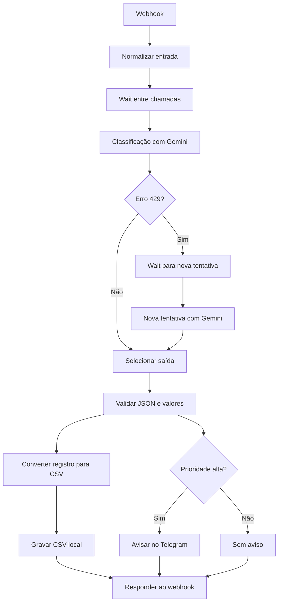

# Diagrama do fluxo

## Capturas de tela

### Fluxo importado no n8n

`[PREENCHER: captura do fluxo completo]`

### Credencial do Gemini selecionada

`[PREENCHER: captura sem chave, token ou identificador]`

### Execução com dados fictícios

`[PREENCHER: captura de uma execução, removendo valores sensíveis]`

### Registro CSV e aviso de alta prioridade

`[PREENCHER: captura do CSV e do Telegram usando apenas dados fictícios]`

